# Willa Ewa

**A website for my aunt's guesthouse in Krynica Morska, a small town on the Polish seaside. My first project for a real client, in production since April 2026.**

### 👉 [willaewanadmorzem.pl](https://willaewanadmorzem.pl)

<table>
<tr>
<td width="100%"></td>
</tr>
</table>

**In short**

- A static site (Astro) with guest reviews written straight into the HTML, because they are the best SEO content the site has.
- Google reviews sync by themselves once a day. The owner approves each one in her panel before it shows up on the site.
- The owner changes photos, prices and texts herself in Sanity CMS, and the site rebuilds itself after every change.
- No server of my own: Cloudflare Pages Functions and a Worker. On my own initiative I cut hosting from about 20 PLN a month on a VPS to 0 PLN (only the domain costs money).
- I started with Express, SQLite and Nunjucks on a VPS. In July I rewrote everything on Astro, Sanity and Cloudflare.
- 438 unique visitors and 170 clicks from Google search in the first 5 months (as of September 2026).

**Stack:** TypeScript · Astro · Sanity · Cloudflare Pages & Workers · SerpAPI · Resend · Telegram Bot API · PhotoSwipe · Swiper · Umami

> The site itself is in Polish, so the screenshots are too. Captions explain what's on them.

---

## How it started

In March 2026 my aunt came to me with a problem. She runs a small guesthouse in Krynica Morska, and most new guests found her through her Google Maps listing.

Some time ago, after a few malicious reports, Google blocked her account. She got it back after contacting support, but it took long enough to show her how fragile that was. If the listing disappeared again, she would lose the main way new guests find her. She needed something that doesn't depend on her Google account.

So I built her a website of her own, where guests can find her, see the prices and ask about free rooms directly.

Reviews were the obvious thing to build it around, because they really are the heart of this business. Willa Ewa isn't a big building with modern apartments right on the beach. It has an owner who puts her heart into it, guests who write about that, and low prices. So I built the whole site around two things: **reviews** and **price**.

<table>
<tr>
<td width="50%">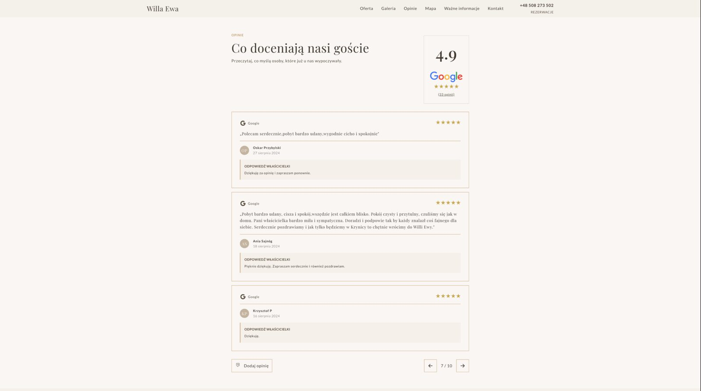</td>
<td width="50%">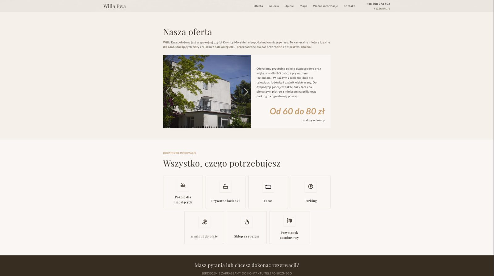</td>
</tr>
<tr>
<td align="center">Reviews: the rating and review count come straight from Google</td>
<td align="center">The price is easy to spot, because it's the second biggest selling point</td>
</tr>
</table>

I built it for next to nothing. What I really got out of it was the chance to build something real, for someone actually waiting for the result. That's why I let myself make the project bigger than a small guesthouse site strictly needs. If she had been paying for every feature, I would have kept it simpler, because I wouldn't talk a client into paying for things she doesn't need that much.

**Why not WordPress?** I had never used it and I don't know PHP. For the custom review handling I would have had to learn it and write plugins. I built the site after hours, next to a full-time job and weekend university classes. I went with what I already knew (TypeScript, HTML, CSS, Express), because that way I was sure I could finish before the season started.

---

## Reviews: the heart of the project

From the start I wanted Google reviews to appear on the site automatically, without anyone copying them by hand. The obvious question came right away: what if someone posts a fake, malicious review and Google doesn't catch it? This isn't about censorship. The owner simply has the right not to have a troll's post in the middle of her website. So every review goes to a panel first and only appears on the site after she approves it.

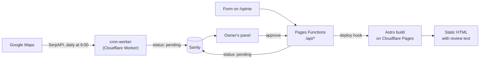

Step by step:

1. Every morning the cron-worker fetches **all** reviews from the listing through SerpAPI and saves new ones in Sanity with the status `pending`.
2. The owner gets an e-mail with a link to the panel, and I get a Telegram message.
3. Guests can also leave a review directly on the site (`/opinie`). It goes down the same path.
4. After approval the site rebuilds itself and the review ends up in the HTML.
5. When the owner replies to a guest on Google Maps, the reply shows up under the review on the site. She replies to reviews left on the site from the panel. The worker walks through the whole review history on every run, not just new reviews, because a reply can land under a review from a year ago.

Code: [cron-worker/src/index.ts](cron-worker/src/index.ts).

<table>
<tr>
<td width="50%" valign="top">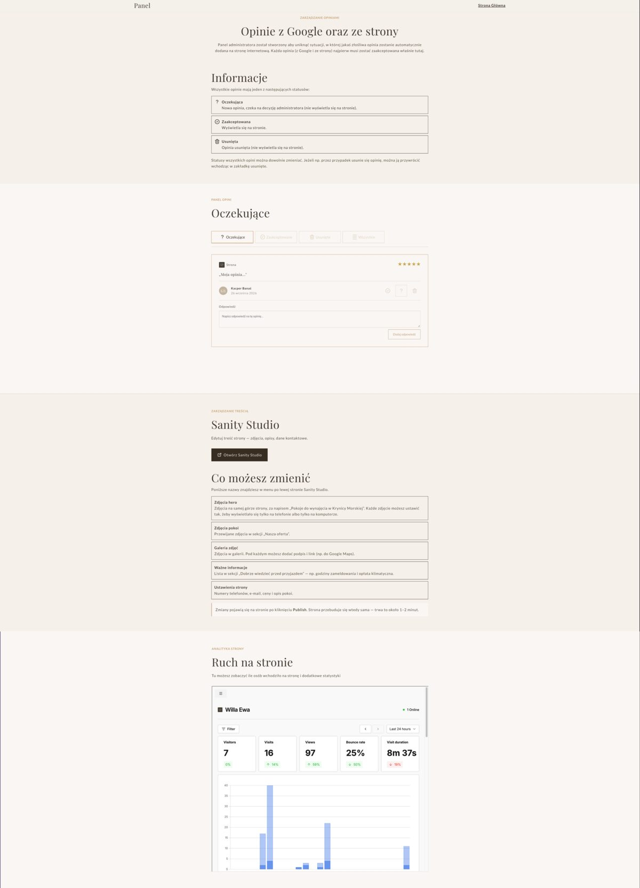</td>
<td width="25%" valign="top"></td>
<td width="25%" valign="top"><br><br></td>
</tr>
<tr>
<td align="center">Panel: review statuses, replies, a guide to Sanity and Umami stats</td>
<td align="center">E-mail to the owner</td>
<td align="center">My Telegram notifications</td>
</tr>
</table>

I wrote the panel for a non-technical person, so every section has a short explanation in plain words. Google reviews can only be hidden, never deleted for good, so a misclick can't destroy anything.

**Why SerpAPI and not the official Google API?** Google does let you fetch all reviews, but the owner would have to set up access herself or give me full access to her Google account. SerpAPI was simply easier, and a daily sync fits in the free plan.

The rating and review count at the top of the section (4.9, 33 reviews) come directly from Google, not from the reviews shown on the site. If I added the site's own reviews to that count, someone checking Google Maps afterwards would see a different number and might think they were being tricked.

### Why the reviews are in the HTML and not loaded with JavaScript

The content changes rarely, it's the same for every visitor, and SEO matters a lot here. So I went with SSG, generating static pages at build time. Reviews are written into the HTML during the build instead of being fetched from a backend in the browser. They're full of natural keywords ("quiet", "close to the beach", "clean"), and in static HTML search engines get them right away.

---

## Lesson 1: I should have reached for a proven solution right away (UX)

After launching the first version I showed the site to family and friends. Partly because I was excited about it, but mostly for feedback, because more eyes means a better chance someone spots a problem. Nobody reported anything. But while watching them browse the photos, I noticed almost everyone did the same things:

1. **They tried to swipe the photo carousel**, which only worked with arrow buttons.
2. **They pinched to zoom in the photo viewer.** That gesture triggered my swipe detection, so the photo changed and the whole page zoomed in at the same time (which was awful).
3. **They double-tapped to zoom**, and everything fell apart.

Nobody said anything, because we're all used to photo viewers on websites working badly. I could have added those gestures myself, but there was no way I'd foresee every gesture, accessibility issue and edge case. So I switched to libraries people have used for years: **Swiper** for the carousel and **PhotoSwipe** for the viewer. Now everything works the way people expect.

<table>
<tr>
<th width="50%">Before: my own carousel, arrows only</th>
<th width="50%">After: Swiper, swipe to browse</th>
</tr>
<tr>
<td align="left"></td>
<td align="left"></td>
</tr>
</table>

---

One more small UX detail: the site remembers in localStorage and a cookie once someone has sent a form. An availability inquiry can be sent again only after 7 days, a review only once. It's there so a regular, non-technical person doesn't accidentally click "Send" ten times and submit the same thing over and over.

<p align="center">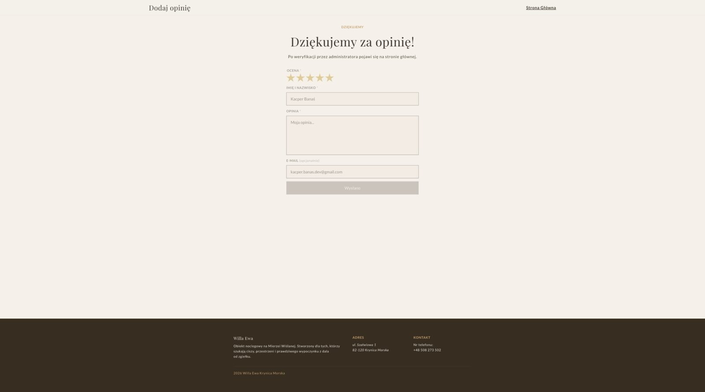</p>
<p align="center"><i>The form locks right after sending, so a second click can't submit it again</i></p>

---

## Lesson 2: content changes more often than I thought

At first I assumed a guesthouse website barely changes. I'd build it, the owner would ask for a few fixes, I'd make them and it would stay that way for years. The commit history shows how that went: a series of "zmiany Ady" and "poprawki Ady" commits ("Ada's changes", Ada being the owner). A forgotten photo that has to be on the site, then a different order in the gallery etc.

Everything was built around my first assumption. I had three photo folders (hero, rooms, gallery), and Vite picked up the files at build time. The order depended on the file name: `0000.webp`, `0001.webp` … `0028.webp`. To put a new photo in second place I had to rename almost 30 files. Fixing the ordering was easy, but a second problem remained: every change still had to go through me.

That's when I found out about **headless CMSs**. The site was already in production, and the code (plain HTML, CSS and TS) had grown messy and hard to navigate. Adding a CMS on top of that would only make it worse, so I rebuilt the site on **Astro and Sanity**. Astro organized the code into components, Sanity has let the owner edit content, and the two work well together. A bonus: Sanity has assets pipeline out of the box, it compresses images and serves them in the size and format that i need, so I no longer have to convert files by hand.

<p align="center">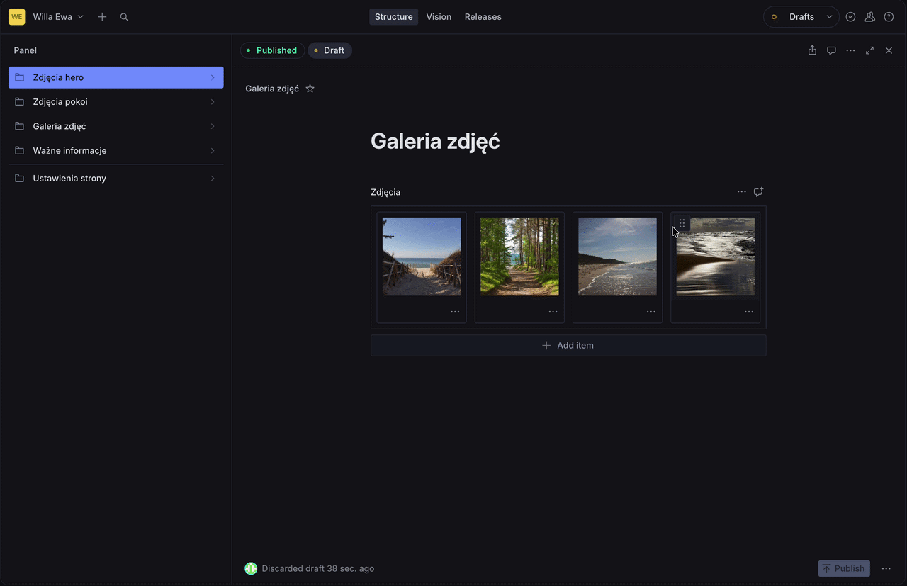</p>
<p align="center"><i>Sanity Studio: reordering photos by drag and drop, and the "phone only / desktop only" option</i></p>

What the owner can change herself:

- **Hero photos:** order, description, and whether a photo shows only on phones or only on computers (some photos look great on a phone but bad on a wide screen, and vice versa).
- **Room photos** in the carousel.
- **The gallery:** a caption under each photo and a link, e.g. to a place on Google Maps.
- **Good-to-know info:** check-in hours, the local tourist tax, the season.
- **Settings:** prices, room description, phone numbers, e-mail.

After she clicks _Publish_, a webhook starts a build on Cloudflare and the change is live within 1–2 minutes. The owner uses it all the time and is really happy with it. Not every project needs a CMS, but this owner is very involved in running her site.

---

## Hero: fast and sharp at the same time

The hero is the first thing a guest sees, so it got the most attention. On the surface it's just a heading over a slideshow. But I wanted the photos to look sharp on big screens while the page still loads fast, even on a weak signal at the seaside. Those two goals pull in opposite directions.

<table>
<tr>
<td align="center" width="50%"></td>
<td align="center" width="50%"></td>
</tr>
<tr>
<td align="center">Slow 4G: a blurred preview and the heading show right away, the real photo a moment later.</td>
<td align="center">The page can be scrolled right away while photos load one by one</td>
</tr>
</table>

How it works:

1. **A blurred preview (LQIP).** Sanity generates a thumbnail of a few hundred bytes. I put it straight into the HTML as the slide background, so there's something to see from the first moment.
2. **The first photo gets priority.** `<link rel="preload">` with `fetchpriority="high"` and a `srcset` of 800/1200 px, so the browser fetches it right away, in a size that fits the screen.
3. **The heading doesn't wait for JavaScript**, because its entrance animation is pure CSS.
4. **Phone-only and desktop-only photos.** The owner ticks this in Sanity. So that a phone doesn't download a photo that opens the slideshow only on desktop, I give it a transparent 1×1 GIF instead.
5. **A slide only changes once the next photo has loaded.** On a slow connection slides are delayed, but never show an empty background.
6. **Full resolution (up to 4500 px) loads in the background**, one photo at a time, only when nothing else is loading, and only on screens where it makes sense (width × pixel density > 1200). The big photo goes into a separate `` on top and appears only after it's decoded, so the blurred background never flashes.

Code: [Hero.astro](astro/src/components/Hero.astro), [lib/hero.ts](astro/src/lib/hero.ts).

The rest I fixed based on Lighthouse: CSS inlined into the HTML, fonts self-hosted instead of loaded from Google Fonts, and gallery and carousel photos sized to the screen.

<p align="center">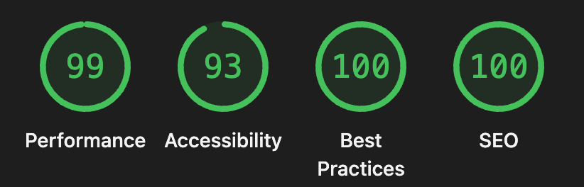</p>
<p align="center"><i>Lighthouse, desktop (September 2026)</i></p>

On mobile, Performance comes out lower (76–82), mostly because of the hero photo's LCP on simulated slow 4G.

---

## Lesson 3: a server that spends 99% of its time waiting

The first version ran on the cheapest VPS at Hetzner (Express, SQLite, nginx, PM2) for about 20 PLN (5 €) a month. The owner was fine with that, but it kept bugging me. 99% of the time the server just waited for requests, and we were paying for the whole machine. Over a year that's 240 PLN (55 €), which is more than three nights at Willa Ewa.

I started looking for another way and found serverless: paying for actual usage instead of a whole server. Cloudflare's free plan gives far more than this site will ever use. Nobody asked me to do this, but if the site can run for free, I figured it should. So I moved everything:

|                  | Version 1 (April–July)                            | Now (since July)                        |
| ---------------- | ------------------------------------------------- | --------------------------------------- |
| Site             | HTML, CSS, TS, Vite, Nunjucks (SSG)               | Astro (static pages)                    |
| API              | Express on a VPS (Hetzner), nginx, PM2            | Cloudflare Pages Functions              |
| Review sync      | cron job on the VPS                               | separate Cloudflare Worker              |
| Reviews          | SQLite                                            | Sanity                                  |
| Photos and texts | files in the repo                                 | Sanity                                  |
| Deploy           | `git push` to the server and a `deploy.sh` script | `git push`, Cloudflare builds by itself |
| Cost             | about 20 PLN/month + domain                       | **0 PLN** + domain                      |

I moved the reviews from SQLite to Sanity instead of setting up a separate database (Cloudflare D1). Sanity was already in the project for photos and content, so reviews reuse the same client, the same API token and the same GROQ queries instead of adding a second piece of infrastructure.

That choice has a real cost: no relational guarantees or transactions. The cron-worker's own `sanityMutate` doesn't check whether a write actually succeeded, so a failed save could go unnoticed, something a real database would make harder to miss. Every query also re-filters the whole `review` collection in GROQ instead of hitting an index, which is fine for the dozens of reviews this site has and would need rethinking at a much larger scale.

---

## Security and spam

The site has two public forms (availability inquiry and adding a review) and a panel login. What protects them:

- **Login:** the password is stored as a bcrypt hash in environment variables. After logging in, the browser gets a JWT in an `HttpOnly`, `Secure`, `SameSite=Strict` cookie, valid for 72 hours. Code: [auth/login.ts](functions/api/auth/login.ts), [\_shared/auth.ts](functions/_shared/auth.ts).
- **Honeypot:** a hidden field that humans don't see but bots usually fill in. When it's filled, the server pretends everything went fine and saves nothing.
- **Rate limiting** per IP: 10 login attempts per 15 minutes (checked before bcrypt), 3 reviews and 5 inquiries per hour. Cloudflare's own rate limiting rules on the free plan only count in 10-second windows, and the Workers rate limiting binding isn't available in Pages Functions, so the counter lives in Cloudflare KV. KV is eventually consistent, so the count is approximate, which is enough to stop password guessing and spam. Code: [\_shared/rate-limit.ts](functions/_shared/rate-limit.ts).
- **Server-side validation**, not just in the browser: field lengths, e-mail and phone format, valid dates, a rating from the allowed values only, and **no links in review text** (including `www.` and bare domains like `spam.pl`). Code: [\_shared/validation.ts](functions/_shared/validation.ts).
- **User text never goes in as HTML.** The panel builds review cards from `<template>` elements and puts user text in with `textContent`, so there's no escaping to forget. E-mails and Telegram messages are HTML text sent out, so there the text is escaped with `escape-html`.
- **Security headers:** CSP, HSTS, `X-Frame-Options`, `nosniff`.
- **The image download endpoint** only works for images from my own Sanity project, so it can't be used as an open proxy.
- `/login`, `/panel` and `/opinie` are `noindex` and left out of the sitemap.

**Mistakes I made:**

- **XSS.** Early versions put review and inquiry text straight into the HTML in the panel and in e-mails, so someone could inject their own code through a public form. I didn't notice it myself; Claude Code found it. I fixed it in July, and in the Telegram messages in September. In October I switched the panel from escaping to `textContent`, so a new field can't bring the XSS back just because someone forgot to escape it.
- **Lost rate limiting.** The Express version had request limits (`express-rate-limit`) on login and the forms. During the move to Cloudflare that layer didn't come along with the rest, and I only noticed while writing this README. It's back now, in KV (see above).
- **Links in reviews.** The "no links" check only looked for `http://`, so `www.spam.pl` got through. Tests I wrote for the validation found it.

---

## Notifications, logs and analytics

On the VPS I logged in over SSH a few times just to download the log file (winston). I quickly decided I needed something more automatic, so I started sending errors and warnings to myself on **Telegram**. Over time everything important ended up there: new reviews, availability inquiries, the Google sync result and cron errors. The owner gets her own version of these notifications by e-mail.

<table>
<tr>
<td width="50%" valign="top">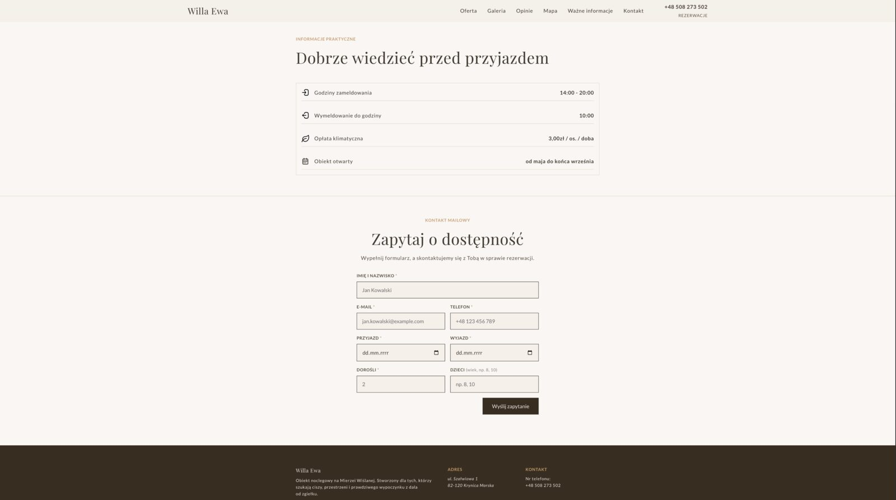</td>
<td width="25%" valign="top">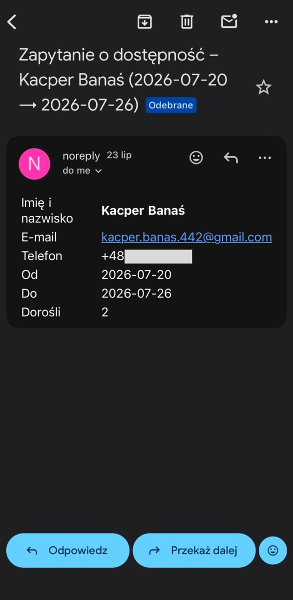</td>
<td width="25%" valign="top"></td>
</tr>
<tr>
<td align="center">The "Ask about availability" form</td>
<td align="center">E-mail to the owner (my own test inquiry)</td>
<td align="center">The same inquiry on my Telegram</td>
</tr>
</table>

- **E-mails** go out through **Resend** from the owner's domain (`noreply@willaewanadmorzem.pl`). I switched to Resend back on the VPS, because Hetzner, like many cheap hosts, blocks outgoing SMTP traffic.
- **Analytics run on Umami.** It has a free plan, it's easy to set up and it gives enough data for a site this size. Most importantly, it doesn't use cookies, so the site doesn't need a cookie banner. I had no use for advanced user tracking here, so I'd rather not bother guests with a banner. For the same reason I self-host the fonts instead of loading them from Google Fonts. The stats are embedded in the owner's panel.

---

## Map and photos

I made the map myself: the style in **Snazzy Maps**, the trails and icons in **Figma**. Below it is a legend with walking or driving times, and every place links to Google Maps.

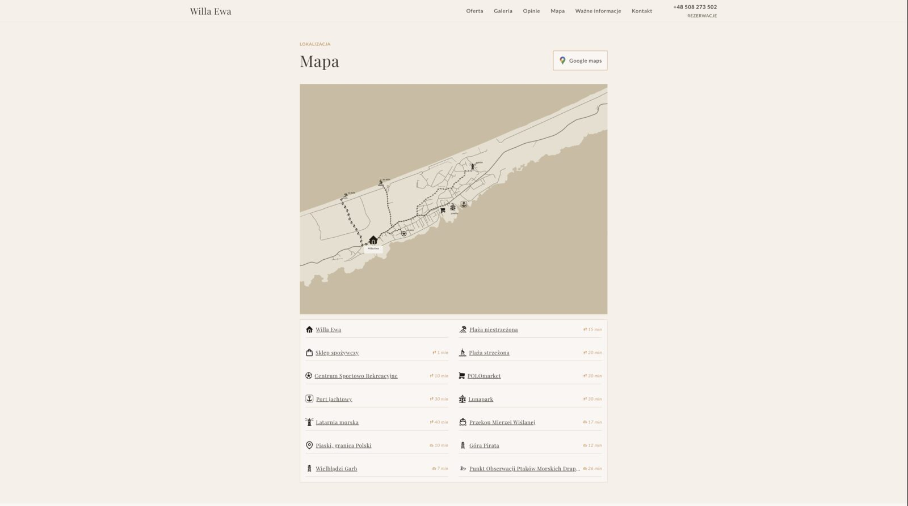

Most photos on the site, including the hero and room photos, I took with my own DSLR. Over time the owner started adding her own through Sanity too.

<details>
<summary><b>More screens</b></summary>
<br>

<table>
<tr>
<td align="center" width="50%"></td>
<td align="center" width="50%"></td>
</tr>
<tr>
<td align="center">Hero on a phone</td>
<td align="center">Menu on a phone</td>
</tr>
<tr>
<td>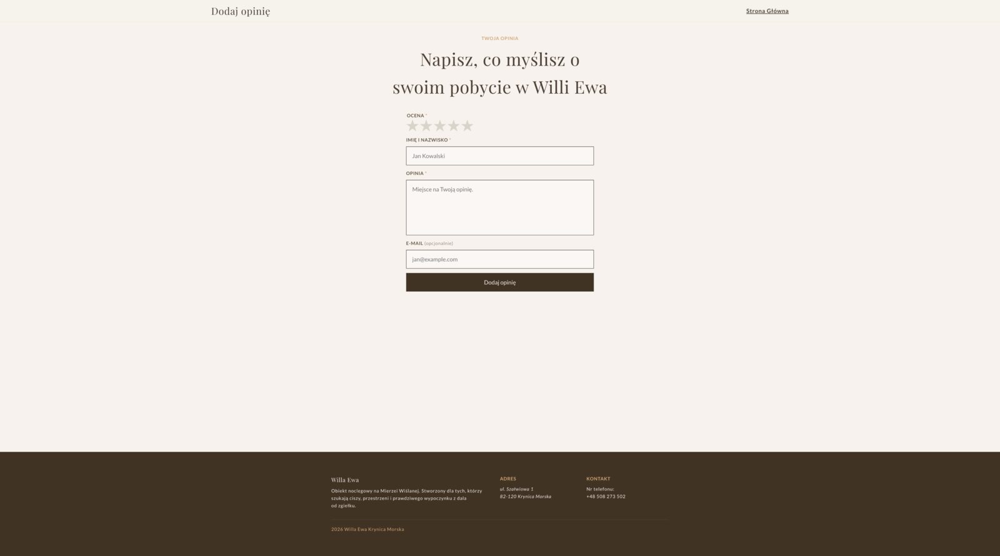</td>
<td></td>
</tr>
<tr>
<td align="center">Add review form</td>
<td align="center">After sending, the form locks</td>
</tr>
<tr>
<td>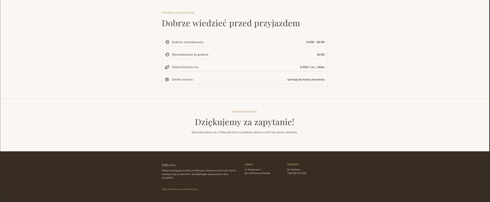</td>
<td>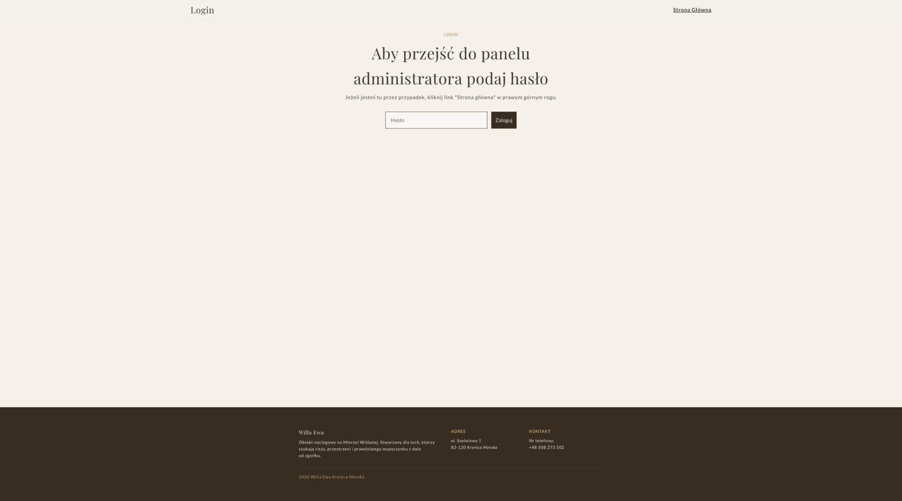</td>
</tr>
<tr>
<td align="center">Availability inquiry sent</td>
<td align="center">Panel login</td>
</tr>
</table>

</details>

---

## By the numbers

_As of September 2026._

- **In production since mid-April 2026**, before the season started. 168 commits so far.
- **438 people** visited the site, more than 1,100 times in total, and stayed over 5 minutes on average.
- **Google search** showed the site about 2,000 times, and 170 people clicked through to it.
- **Hosting costs 0 PLN** a month. Only the domain is paid.

It's a small site with small numbers, but behind them are real people looking for a place to stay.

---

## Working with AI

I started writing this project myself, and over time I did more and more of it with AI. I did the migration to Astro, Sanity and Cloudflare with **Claude Code**, and today I use it for pretty much everything: writing code, refactoring and reviewing for security issues (that's how the XSS described above was found). Some commits are marked `Co-Authored-By: Claude`. For the visual design I used **Claude Design** to try ideas quickly, then refined the design my own way.

On my side are the conversations with the owner, spotting problems, making the decisions and knowing why, testing by hand, and making sure the site works during the season.

---

## What I'd do differently, and what's next

- **Tests from the start.** For months I tested everything by hand. In October I added the first tests (validation, rate limiting, escaping in notifications) and CI that runs them with a type check on every pull request. The first batch already found the link gap described above. The pages and the panel still have no automated tests. I'm also learning testing on my second project, [meal-journal](https://github.com/kbanass/meal-journal).
- **A list of "what the old system does" before migrating.** Rate limiting got lost along the way during the move to Cloudflare, and I only noticed more than two months later.
- **A CMS from day one**, when the client is as involved as this one.
- **A branch and a pull request instead of fixes in production.** At first I fixed bugs directly in production: the history has five "TypeScript errors fixed" commits within 40 minutes. Since September every change goes through its own branch and PR.

---

<details>
<summary><b>For developers: repo structure and running it locally</b></summary>

### Structure

```
astro/          the site (Astro, output: "static"), hosted on Cloudflare Pages
functions/      the site's API: Cloudflare Pages Functions (/api/*)
cron-worker/    a separate Cloudflare Worker: daily Google review sync (SerpAPI → Sanity)
sanity/studio/  Sanity Studio: photos, site settings, good-to-know info, reviews
tests/          Vitest tests for the Functions
```

- **Deploying the site:** push to `main`, and Cloudflare Pages builds `astro/` and deploys `functions/`.
- **CI:** every pull request runs the type check, the tests and `astro check` (GitHub Actions).
- **Sanity webhook:** publishing content in Sanity calls `/api/rebuild`, which triggers the Cloudflare Pages deploy hook.
- **cron-worker** is deployed separately, from `main`: `cd cron-worker && npm install && npx wrangler deploy`.

In `astro/src/`:

- `lib/site.ts`: business details (name, address, fallback phone numbers). Numbers set in Sanity take priority.
- `lib/sanity.ts`: the Sanity client and GROQ queries.
- `lib/hero.ts`, `lib/lightbox.ts`, `lib/reviews.ts`: logic shared between components.
- `styles/variables.css`: colors, fonts and spacing. Add new values here.

### Running locally

```sh
npm install && (cd astro && npm install)
npm run dev          # builds the site and serves it together with Pages Functions (wrangler)
npm test             # Vitest
npm run typecheck    # tsc for functions/ and cron-worker/
```

Secrets for the Functions live locally in `.dev.vars` (not in the repo). Sanity Studio: `cd sanity/studio && npm install && npm run dev`.

### Sanity types

`sanity/studio/schema.json` and `astro/src/sanity.types.ts` are generated and kept in the repo, because the Cloudflare build doesn't generate them. After changing a schema or a GROQ query:

```sh
cd sanity/studio && npm run typegen
```

### Environment variables

Set in the Cloudflare dashboard or with `wrangler secret put`:

- `SANITY_PROJECT_ID`, `SANITY_DATASET`, `SANITY_API_TOKEN`
- `JWT_SECRET`, `ADMIN_PASSWORD_HASH`: panel login
- `SERPAPI_API_KEY`, `GOOGLE_PLACE_ID`: review sync (cron-worker)
- `RESEND_API_KEY`, `MAIL_FROM`, `OWNER_EMAIL`: e-mails
- `TELEGRAM_BOT_TOKEN`, `TELEGRAM_CHAT_ID`: Telegram notifications (optional)
- `CF_PAGES_DEPLOY_HOOK`: rebuilds the site after review changes
- `DOMAIN_NAME`, `REBUILD_SECRET` (optional Sanity webhook secret)

Bindings (Pages → Settings → Bindings, for Production and Preview):

- `RATE_LIMIT_KV`: KV namespace for rate limiting. Without it the limits are off and the Functions logs show a warning. `npm run dev` binds a local one.

</details>

---

## Author

**Kacper Banaś** · [LinkedIn](https://www.linkedin.com/in/kacper-bana%C5%9B-061b9933b) · [GitHub](https://github.com/kbanass) · [kacper.banas.dev@gmail.com](mailto:kacper.banas.dev@gmail.com)

I'm looking for my first job as a junior developer.
